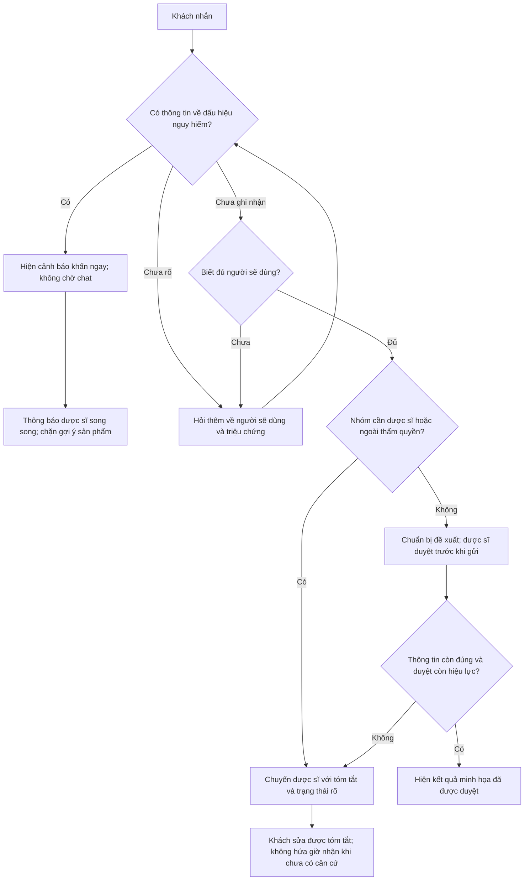

# Hiểu nguyên lý và flow của LAB5 — T1 Y tế

Tài liệu này giải thích cách giải bài. Các quyết định cụ thể và bằng chứng chạy thử sẽ được đối chiếu với bài làm thực tế, không dùng tài liệu này để tự nhận đã demo hoặc được chấm điểm.

## 1. Bài toán thực sự là gì?

Một khách nhắn hỏi thuốc. Người dùng thuốc có thể là chính khách, con nhỏ, cha mẹ hoặc người đang mang thai. AI phải quyết định có thể hỗ trợ ở mức nào: hỏi thêm, đưa thông tin có giới hạn, chuyển dược sĩ, hoặc cảnh báo cần đi khám ngay.

Bạn cần giải hai bài toán gắn chặt nhau:

1. **Trải nghiệm khi AI thiếu căn cứ hoặc sai:** khách nhận được câu gì, thấy gì và có thể làm gì tiếp?
2. **Quyền hành động:** việc nào AI được tự làm, việc nào phải được đúng người duyệt, việc nào bị cấm?

Một lời đáp có vẻ đúng vẫn có thể là một quyết định sai. Ví dụ: AI đoán đúng sản phẩm cho người lớn nhưng chưa biết khách đang hỏi cho trẻ nhỏ. Cách thiết kế đó dựa vào may mắn, chưa có cơ chế kiểm soát lỗi.

## 2. Vì sao phải bắt đầu bằng kịch bản, chưa vẽ màn hình ngay?

Màn hình đẹp không cho bạn biết lỗi nào cần chặn. Hãy bắt đầu từ một tin nhắn có thể xảy ra, tìm hành động AI dễ làm sai, rồi truy đến hậu quả.

Ví dụ: “Con mình 5 tuổi sốt, đang khó thở và lơ mơ, có thuốc gì không?”

- Tin nhắn chứa yêu cầu mua nhưng cũng chứa dấu hiệu cần hỗ trợ khẩn.
- Nếu chỉ tối ưu trả lời đúng câu “có thuốc gì”, AI dễ gọi `goi_y_san_pham`.
- Nếu chỉ tối ưu “chuyển mọi câu chuyên môn cho dược sĩ”, AI có thể đưa khách vào hàng chờ.
- Cả hai cách đều bỏ sót nhu cầu quan trọng hơn: khách cần biết không nên chờ chat.

Vì vậy bốn lớp rủi ro trong đề giúp bạn tìm những kiểu sai khác nhau: dữ liệu không có; người dùng nói thiếu; yêu cầu ngoài quyền; hậu quả riêng của y tế.

## 3. Dùng “cái giá khi sai” để chọn mức tự chủ

Với mỗi hành động, xét đồng thời bốn điều:

- Sai thì ai chịu hậu quả?
- Hậu quả có thể khắc phục hoàn toàn không?
- Ai có khả năng phát hiện và sửa trước khi thiệt hại xảy ra?
- Chờ duyệt có gây thiệt hại khác không?

Đừng dùng “AI thông minh” hoặc “có người duyệt là an toàn” thay cho lập luận. Khách đồng ý mua chưa chứng minh khách có chuyên môn đánh giá lựa chọn thuốc. Một bước bấm xác nhận cũng không thay thế được dược sĩ trong trường hợp này.

Tương tự, yêu cầu dược sĩ duyệt cả cảnh báo khẩn có thể khiến cảnh báo xuất hiện quá muộn. Mức tự chủ phải được chọn theo từng hành động, không đặt một mức chung cho cả trợ lý.

## 4. Flow thiết kế cần suy nghĩ theo thứ tự nào?

Đây là flow sản phẩm cho bài học, không phải hướng dẫn chẩn đoán hay quy trình y tế đã được thẩm định. “Chưa ghi nhận dấu hiệu nguy hiểm” không có nghĩa là “đã chứng minh an toàn”.

## 5. Vì sao phải thiết kế cả lúc khách sửa AI?

Giả sử AI đã đưa thẻ gợi ý trước khi biết khách đang mang thai. Khách nhắn bổ sung thông tin. Chỉ trả lời “xin lỗi, để mình xem lại” sẽ để thẻ gợi ý cũ tiếp tục có thể được chọn.

Thiết kế cần giải quyết **trạng thái**, không chỉ câu chữ:

1. Đánh dấu gợi ý cũ không còn hợp lệ.
2. Chặn hành động tiếp tục dùng gợi ý cũ.
3. Huỷ hiệu lực của phê duyệt cũ nếu thông tin đầu vào đã đổi.
4. Nói rõ AI đã thiếu thông tin gì, không đổ lỗi vì khách chưa nói từ đầu.
5. Chuyển dược sĩ, kèm thông tin khách đã dùng sản phẩm hay chưa nếu có.

Thu hồi một thẻ có thể chặn thao tác tiếp theo, nhưng không đảo ngược được việc thuốc đã dùng. Đây là lý do “có nút hoàn tác” không đủ để biện minh cho mọi mức tự chủ.

## 6. Quyền riêng tư nằm ở đâu trong flow?

Ba việc khác nhau cần được phân biệt:

- Dùng nội dung khách vừa gửi để xử lý cuộc trao đổi hiện tại.
- Bàn giao phần thông tin cần thiết cho dược sĩ trong cuộc hỗ trợ.
- Giữ lại ghi chú sức khoẻ vào hồ sơ cho lần sau.

Không lấy việc khách tiếp tục chat làm đồng ý lưu hồ sơ. Không bắt khách đồng ý lưu để được nhìn thấy cảnh báo khẩn. Nếu khách không đồng ý lưu, hỗ trợ hiện tại vẫn phải tiếp tục.

Khi có đồng ý, khách cần biết nội dung nào được lưu và có cách rút lại/xoá. Trong prototype có thể mô phỏng việc này; phải ghi rõ dữ liệu tồn tại trong bộ nhớ hay nơi lưu nào, thay vì nói “đã lưu vào hồ sơ thật”.

## 7. Từ nguyên tắc HAX/PAIR đến một nút trên màn hình

Một nguyên tắc chỉ hữu ích khi nó thay đổi được hành vi của sản phẩm:

| Nguyên tắc | Câu hỏi thiết kế | Bằng chứng có thể chỉ được |
|---|---|---|
| G2 — Làm rõ hệ thống làm tốt đến đâu | AI đang thiếu điều gì? | Nhãn “chưa biết người sẽ dùng”, thay cho phần trăm tự tin dựng |
| G10 — Thu hẹp khi nghi ngờ | Khi chưa đủ thông tin, AI dừng việc gì? | Không cho gửi gợi ý; hỏi thêm hoặc chuyển dược sĩ |
| G9 — Sửa dễ dàng | Khách sửa thông tin và kết quả cũ thế nào? | Nút sửa hồ sơ sàng lọc, thẻ cũ bị thu hồi và duyệt cũ hết hiệu lực |

Ba nguyên tắc trên là gợi ý để phân tích. Nếu bài làm chọn nguyên tắc khác, cần đổi cả bảng đối chiếu, ảnh và lời giải thích cho nhất quán.

## 8. Vì sao cần prototype bấm được?

Một bản spec có thể nói “cần duyệt trước khi gửi”, nhưng nút gửi trong giao diện vẫn bấm được khi chưa duyệt. Một đồng hồ có thể hiện “đã hết hạn” nhưng kết quả vẫn có hiệu lực.

Prototype giúp kiểm tra sự thống nhất giữa ba lớp:

1. **Chính sách:** tuyên bố hành động nào được phép.
2. **Trạng thái:** hệ thống đang thiếu gì, chờ ai, thông tin nào còn hiệu lực.
3. **Điều khiển:** nút nào thực sự dùng được trong trạng thái đó.

Việc cấm cần được chặn ở logic xử lý, không chỉ giấu một nút. Việc cần duyệt cần kiểm tra lại dữ liệu khi duyệt, không tin một phê duyệt đã lỗi thời.

## 9. Chọn kiểm tra gì để tránh tự chấm mình bằng cảm giác?

Ba tiêu chí tốt nên có điều kiện quan sát cụ thể:

- **Khẩn không phải chờ:** ca dựng có dấu hiệu nguy hiểm hiển thị cảnh báo ngay và không có gợi ý mua đang hoạt động.
- **Không hành động quá quyền:** chưa đủ thông tin hoặc chưa có phê duyệt đúng người thì chưa phát hành gợi ý; thông tin đổi làm duyệt cũ mất hiệu lực.
- **Có đường sửa, có quyền chọn lưu:** khách sửa được thông tin, rút được gợi ý chưa dùng; ghi chú mặc định không lưu và có thể xoá sau đồng ý.

Chấm các tiêu chí này trên hai ca đắt nhất trước, rồi một ca bình thường để xem thiết kế có vô tình bắt mọi người chờ vô ích không. Kiểm tra một ca lạ hoặc chưa có trong danh sách để xác minh đường xử lý khi không hiểu.

## 10. Những câu bạn nên tự giải thích được

1. Vì sao người nhắn và người sẽ dùng thuốc là hai khái niệm khác nhau?
2. Vì sao chuyển dược sĩ không được làm chậm cảnh báo khẩn?
3. Vì sao khách bấm “đồng ý” chưa đủ để duyệt một gợi ý chuyên môn?
4. Phần nào trong flow được tự làm, phần nào cần duyệt và phần nào bị cấm?
5. Khi khách bổ sung thông tin mới, gợi ý cũ và duyệt cũ phải thế nào?
6. Vì sao dùng nội dung trong cuộc chat khác với lưu ghi chú sức khoẻ vào hồ sơ?
7. Nếu không có dược sĩ trực hoặc yêu cầu chuyển thất bại thì lời hứa với khách đổi thế nào?
8. Prototype chứng minh được điều gì và chưa chứng minh được điều gì?

## Nguồn và giới hạn

- Tài liệu chính là `README.md`, `01-challenge-brief.md`, `02-guide.md`, `03-spec-template.md`, `04-rubric.md` và `tracks/t1-healthcare.md` của đề.
- Đối chiếu bổ sung cho tình huống trẻ khó thở/khó đánh thức: [NHS — When to get urgent medical help for babies and children under 5](https://www.nhs.uk/baby/health/when-to-get-urgent-medical-help-for-babies-and-children-under-5/). Nguồn này đặt các dấu hiệu đó trong nhóm cần hỗ trợ khẩn; số điện thoại của Anh không được dùng làm số Việt Nam.
- Kênh cấp cứu Việt Nam tham khảo: [Cổng Chính phủ — hướng dẫn cấp cứu trẻ, nguồn Bệnh viện Nhi Trung ương](https://xaydungchinhsach.chinhphu.vn/huong-dan-cac-buoc-cap-cuu-tai-cho-tre-duoi-nuoc-119221010142150911.htm), có nêu gọi hỗ trợ 115. Bài làm không mô phỏng việc đã gọi, đã điều xe hay đã có người thật tiếp nhận.
- Tài liệu này phục vụ học thiết kế. Không đưa thuốc, liều hay chẩn đoán cho người thật.
