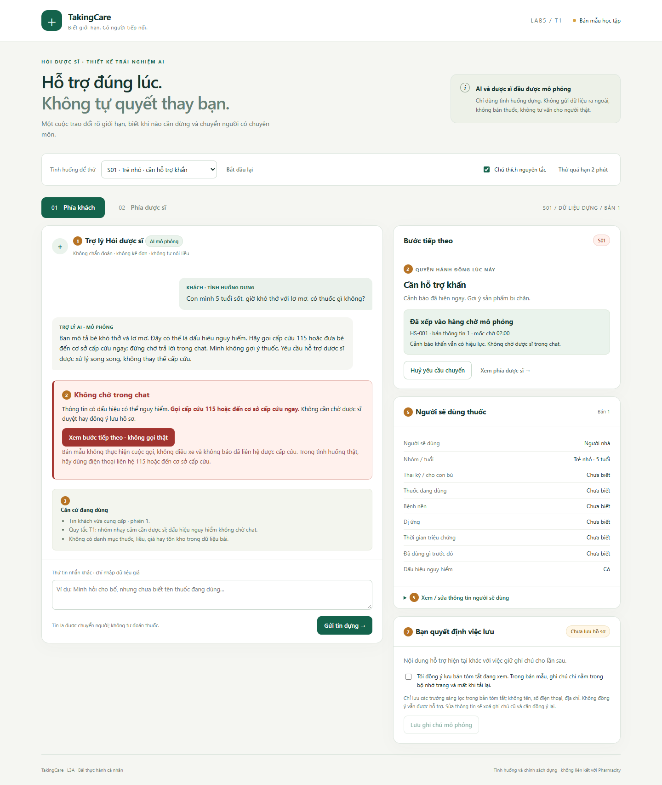
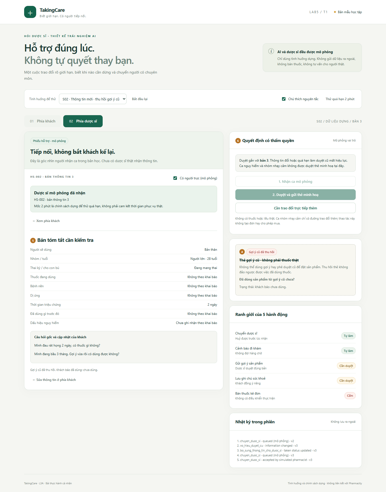

# Prototype — hai màn hình, một flow có quyền kiểm soát

Mở [index.html](index.html) trực tiếp bằng trình duyệt. Dùng tab **01 Phía khách** / **02 Phía dược sĩ** để xem đúng hai màn hình của bài. Mỗi tình huống là một trạng thái của hai màn hình đó, không phải một sản phẩm mới.

## Ảnh chú thích

| Số | Vị trí | Nguyên tắc / quyền |
|---|---|---|
| ① | Tên trợ lý và giới hạn | G2 — biết mình đang làm việc với AI mô phỏng |
| ② | Cảnh báo và bước tiếp theo | G10 — không tự gợi ý khi phải dừng; khẩn không chờ duyệt |
| ③ | Căn cứ/nguồn không có | G2 — không tạo cảm giác chắc chắn bằng số % dựng |
| ④ | Thu hồi gợi ý cũ, hỏi đã dùng chưa | G9 — sửa kết quả; không hứa đảo ngược việc đã dùng |
| ⑤ | Tóm tắt người dùng và sửa | G9 — sửa thông tin làm duyệt cũ mất hiệu lực |
| ⑥ | Nhận và duyệt đúng phiên | G10 — cần đúng người; hết hạn/nhạy cảm không được duyệt thẻ |
| ⑦ | Đồng ý lưu và rút/xoá | G9 — quyền sửa/rút lựa chọn lưu của khách |

Ảnh là ảnh thật từ trình duyệt chạy prototype, có thể tạo lại bằng `npm run test:browser`. [Kết quả chạy](evidence/browser-results.json) ghi tên các kiểm tra; không phải log gọi AI thật.

## Phần nào được mô phỏng?

- Không gọi AI: câu trả lời và phân nhánh do quy tắc cục bộ thực hiện.
- Không có dược sĩ thật: người xem có thể chuyển tab để đóng vai. Đây không phải cơ chế xác thực người có chuyên môn.
- Không có thuốc thật: THẺ MINH HOẠ A không phải sản phẩm để dùng hay mua.
- Không gọi 115: nút bước tiếp theo chỉ mở giải thích. Không nói đã gọi hay đã điều xe.
- Hàng chờ 2 phút và trạng thái online/offline là dữ liệu dựng để thử thất bại/quá hạn.
- Ghi chú sức khoẻ chỉ trong bộ nhớ trang, không dùng cookie, localStorage, IndexedDB hoặc mạng; tải lại là mất. Mã nguồn cũng không chứa API key.
- Tin tự do chỉ hỗ trợ một số cụm dấu hiệu từ bài; không đủ để đánh giá sức khoẻ. Tin không hiểu chuyển người, không tự sinh tên thuốc/liều.

## Những việc bấm được

Chọn bảy ca dựng, thêm tin lạ, sửa đủ các trường sàng lọc, bổ sung thai kỳ, ghi đã/chưa dùng, xem thu hồi, chuyển/huỷ trước nhận, người nhận tiếp nhận, duyệt khi hợp lệ, thử quá hạn/gửi lại, tắt người trực, đồng ý lưu/xoá và bắt đầu lại. Logic kiểm tra quyền chạy ở hành động xử lý, không chỉ dựa vào việc nút bị ẩn hay mờ.
